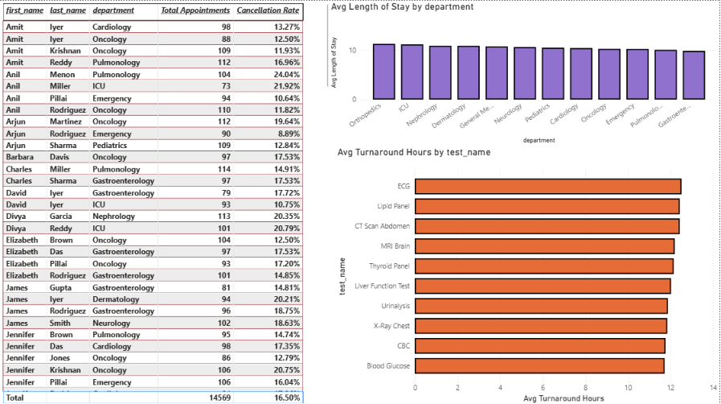
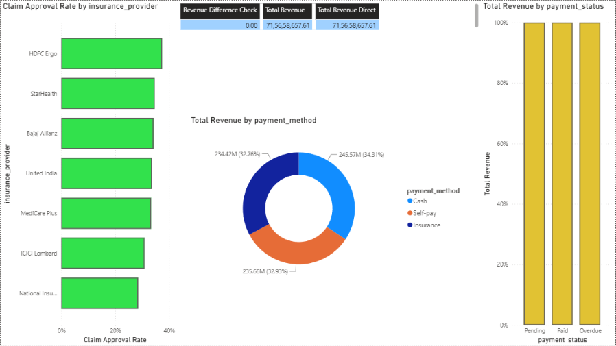

# MediFlow Analytics

An end-to-end healthcare data engineering and business intelligence platform that ingests, validates, transforms, stores, and analyzes hospital operational data through a modular Python ETL pipeline, PostgreSQL, SQL analytics, and interactive Power BI dashboards — fully automated with scheduled unattended runs and a regression-tested pipeline.

## Problem Statement

Hospital data is fragmented across independent operational systems — registration, scheduling, labs, pharmacy, billing, insurance — so hospital management cannot easily answer basic operational, financial, and clinical questions without manually cross-referencing multiple sources. MediFlow Analytics centralizes this data into a single analytics platform so management can identify inefficiencies and make faster, evidence-based decisions.

## Status: Complete ✅

| Phase | Description | Status |
|---|---|---|
| 0 | Business Understanding | ✅ |
| 1 | Project Setup | ✅ |
| 2 | Dataset Collection & Generation | ✅ |
| 3 | Database Design (PostgreSQL) | ✅ |
| 4 | Extract Layer | ✅ |
| 5 | Transform Layer | ✅ |
| 6 | Load Layer | ✅ |
| 7 | SQL Analytics | ✅ |
| 8 | Power BI Data Modeling | ✅ |
| 9 | Dashboard Development | ✅ |
| 10 | Automated Testing (pytest) | ✅ |
| 11 | Automation & Scheduling | ✅ |
| 12 | Documentation | ✅ |

---

## Architecture

```
                     ┌─────────────────┐
                     │  Synthetic Data  │
                     │   Generator      │  (scripts/generate_data.py)
                     └────────┬────────┘
                              │  8 raw CSVs
                              ▼
                     ┌─────────────────┐
                     │     EXTRACT      │  structural validation only
                     │  etl/extract.py  │  (file exists, columns match)
                     └────────┬────────┘
                              ▼
                     ┌─────────────────┐
                     │    TRANSFORM     │  business-rule cleaning:
                     │ etl/transform.py │  dedup, orphan-FK filtering,
                     └────────┬────────┘  derived columns, quarantine
                              │  clean DataFrames + rejected/*.csv
                              ▼
                     ┌─────────────────┐
                     │      LOAD        │  transactional truncate +
                     │   etl/load.py    │  reload, row-count verification
                     └────────┬────────┘
                              ▼
                     ┌─────────────────┐
                     │   PostgreSQL     │  8 normalized tables,
                     │ mediflow_analytics│ 12 FK constraints, 15 CHECK
                     └────────┬────────┘  constraints, 17 indexes
                              │
                ┌─────────────┴─────────────┐
                ▼                             ▼
     ┌─────────────────┐           ┌─────────────────┐
     │   SQL Analytics  │           │    Power BI      │
     │ 11 queries: core  │           │  3-page dashboard │
     │ + CTEs + window   │           │  12 relationships, │
     │ functions          │           │  9 DAX measures    │
     └─────────────────┘           └─────────────────┘

     run_pipeline.py orchestrates Extract → Transform → Load → Verify,
     scheduled daily via Windows Task Scheduler, with exit codes for
     automated failure detection. tests/ (pytest) covers Extract and
     Transform logic, including regression tests for real bugs found
     during development (below).
```

## Tech Stack

**Language & Libraries:** Python 3.13, Pandas, NumPy, SQLAlchemy, psycopg2, PyYAML, python-dotenv, pytest
**Database:** PostgreSQL 18
**BI/Visualization:** Power BI Desktop (DAX, CTEs, window functions)
**Automation:** Windows Task Scheduler
**Version Control:** Git

---

## Business Questions Answered

Mapped directly to hospital stakeholders (Executive Board, Department Heads, Doctors, Finance, Lab Management):

- Which departments generate the most revenue, and which need additional resources?
- What is each doctor's appointment workload, cancellation, and no-show rate?
- What is the average length of stay by department?
- Which insurance providers have the lowest claim approval rates?
- Which lab tests have the worst turnaround times / are backlogged?
- What is the month-over-month revenue trend?
- Who are the top-performing doctors within each department?

---

## Bugs Found & Fixed During Development

This project surfaced three genuine data engineering bugs during development — not hypothetical edge cases, but real issues caught by the pipeline's own validation layers, schema constraints, and test suite. Each is documented here because *finding and fixing real bugs* is a stronger engineering signal than a pipeline that never encounters any.

### 1. Registration date generated before date of birth

**Found by:** PostgreSQL's `chk_patients_registration_after_dob` CHECK constraint, rejecting a load at the database layer.

**Root cause:** `scripts/generate_data.py` originally generated `date_of_birth` and `registration_date` from two independent random ranges. Since `date_of_birth` could be as recent as late 2023 and `registration_date` could start as early as 2018, nothing prevented a patient from having a registration date *before* their own birth.

**Fix:** `registration_date` is now generated as a random date within `[max(date_of_birth, 2018-01-01), 2026-07-01]`, guaranteeing it can never precede the patient's birth.

**Why it matters:** proves the database schema's constraints are doing real work, not just decorative — they caught a genuine logic bug in upstream data generation before it reached the database.

### 2. Cascading orphan foreign keys across every child table

**Found by:** A `ForeignKeyViolation` at Load time on the `admissions` table, despite `appointments` loading successfully.

**Root cause:** The Transform layer's orphan-foreign-key filtering was only implemented for the `appointments` table. When duplicate patient records were correctly removed during patient deduplication, every other table referencing those now-deleted patient IDs (`admissions`, `lab_results`, `pharmacy`, `billing`, `insurance_claims`) was left with dangling references — but only `appointments` was actually being checked for this.

**Fix:** Built a shared `_filter_orphan_fk()` helper and applied it consistently across **every** child table, including the nullable `billing.admission_id` case (only quarantined when set AND invalid) and the two-level dependency in `insurance_claims` (validated against both `bill_id` and `patient_id`).

**Why it matters:** a bug passing tests on one table doesn't guarantee the same guarantee holds on structurally similar tables sharing the same dependency — this is a genuinely common and underrated class of data pipeline bug.

### 3. Phone number silently corrupted to "9876543210.0"

**Found by:** Manual inspection in Power BI, then traced back through the pipeline to its root cause.

**Root cause:** `pandas` silently upcasts an integer-like column to `float64` the moment **any** row in that column is missing (`NaN` cannot exist in an integer column). Since `patients.phone_number` has a deliberately-seeded 3% missing rate, the entire column silently became floats — e.g. `9876543210` became `9876543210.0` — and that float representation was written into PostgreSQL's `VARCHAR` column as literal text, `.0` and all. `doctors.phone_number` never showed the bug, since it has zero missing values.

**Fix:** `transform_patients()` now explicitly casts `phone_number` to a clean string (or a true `None` for missing values) before it ever reaches the database.

**Why it matters:** a great example of a bug that only manifests conditionally (present with missing data, absent without it) — exactly the kind of thing a fixed-data smoke test would never catch, and exactly why the pytest regression test below exists.

---

## Testing

```bash
python -m pytest tests/ -v
```

23 automated tests across Extract (structural validation) and Transform (business rules), including an explicit regression test for the phone_number bug above — verified during development by deliberately reintroducing the bug and confirming the test suite caught it before restoring the fix.

## Automation

The full pipeline runs unattended, daily at 2 AM, via Windows Task Scheduler, calling:

```bash
python run_pipeline.py
```

Returns exit code `0` on success, `1` on failure (with the specific failed stage logged), enabling automated failure detection.

---

## Project Structure

```
MediFlow-Analytics/
├── data/
│   ├── raw/                  # generated CSVs (gitignored, reproducible)
│   └── processed/
│       └── rejected/         # quarantined rows with rejection_reason
├── database/
│   └── schema.sql            # PostgreSQL DDL: 8 tables, FKs, CHECKs, indexes
├── etl/
│   ├── extract.py
│   ├── transform.py
│   └── load.py
├── scripts/
│   └── generate_data.py      # synthetic data generator (seeded, reproducible)
├── sql/
│   └── analytics_queries.sql # 11 queries: 7 core + 4 advanced (CTEs/window fns)
├── tests/
│   ├── conftest.py
│   ├── test_extract.py
│   └── test_transform.py
├── config/
│   └── config.yaml           # non-secret configuration
├── .env.example               # required environment variables (template)
├── run_pipeline.py            # orchestrator: Extract → Transform → Load → Verify
├── requirements.txt
└── README.md
```

## Setup

```bash
git clone <repo-url>
cd MediFlow-Analytics
python -m venv venv
venv\Scripts\Activate.ps1        # Windows
pip install -r requirements.txt
cp .env.example .env             # fill in your PostgreSQL credentials

# Create the database
psql -U postgres -c "CREATE DATABASE mediflow_analytics;"
psql -U postgres -d mediflow_analytics -f database/schema.sql

# Generate synthetic data and run the full pipeline
python scripts/generate_data.py
python run_pipeline.py

# Run tests
python -m pytest tests/ -v
```

## Dashboard

Three Power BI report pages:

### Executive Overview
KPI cards (patients, revenue, appointments, doctors, completion rate), revenue trend, revenue by department.


### Department & Doctor Performance
Doctor workload table, average length of stay by department, lab turnaround time by test.



### Financial & Insurance
Claim approval rate by provider, revenue by payment method/status, direct-relationship revenue validation (`USERELATIONSHIP`).



### Full interactive report
The complete `.pbix` file is included in this repo under `powerbi/mediflow-analytics.pbix` — download it and open in [Power BI Desktop](https://www.microsoft.com/en-us/power-platform/products/power-bi/downloads) (free) to explore interactively, including live filtering, drill-through, and the underlying DAX measures.

## License

Personal portfolio project.