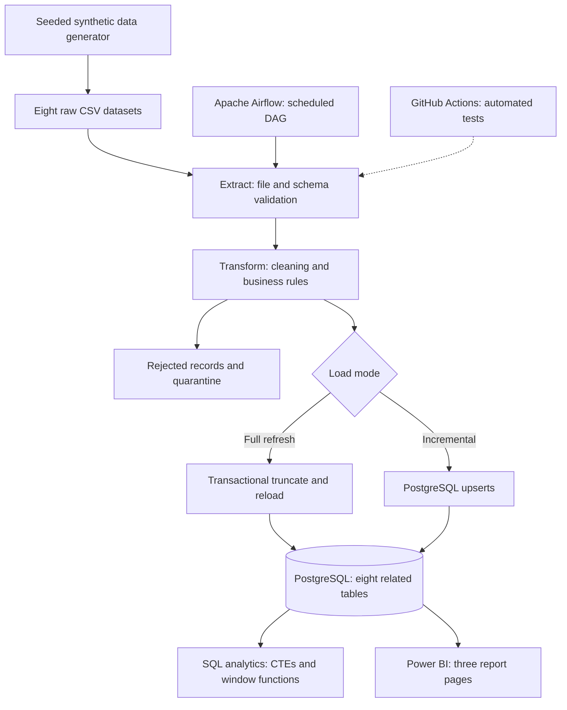
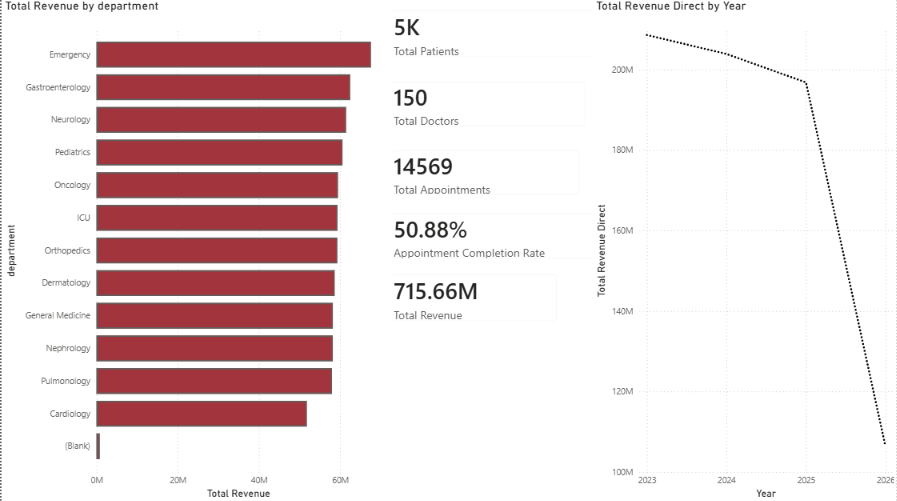

# MediFlow Analytics

**Healthcare data engineering and business intelligence | Python · PostgreSQL · Docker · Apache Airflow · Power BI · GitHub Actions**

MediFlow Analytics is an end-to-end healthcare analytics project that generates synthetic hospital data, validates and transforms eight operational datasets, loads them into a relational PostgreSQL database, and makes them available for SQL analysis and interactive Power BI reporting.

The project goes beyond a one-off ETL script: it includes **full-refresh and incremental load modes**, data-quality quarantine, transactional database loading, regression tests, Docker-based execution, scheduled Apache Airflow orchestration, and GitHub Actions CI.

> **Data disclaimer:** All hospital records are synthetically generated for this portfolio project. No real patient data is used.

## Why this project exists

Hospital data is often split across patient registration, appointments, admissions, laboratories, pharmacy, billing, and insurance systems. Answering operational and financial questions across those systems requires consistent identifiers, reliable data quality, and a shared analytical database.

MediFlow brings these datasets together so stakeholders can explore patient activity, departmental workloads, revenue trends, insurance claims, and service performance.

## Architecture



`run_pipeline.py` coordinates extraction, transformation, and loading. The pipeline selects its configuration through `MEDIFLOW_CONFIG` and its load strategy through `MEDIFLOW_LOAD_MODE`.

### Database and analytics

- **8 PostgreSQL tables:** `patients`, `doctors`, `appointments`, `admissions`, `lab_results`, `pharmacy`, `billing`, and `insurance_claims`.
- **Relational integrity:** 12 foreign-key constraints, 15 CHECK constraints, and 17 indexes in the schema.
- **SQL analysis:** 11 analytical queries, including common table expressions and window functions.
- **Power BI:** 3 dashboard pages, with 12 model relationships and 9 DAX measures.

## Engineering features

### Extraction and data quality

The Extract layer checks source-file presence, expected columns, and nonempty datasets. The Transform layer standardizes values, removes duplicates, computes derived fields, validates relationships, and separates rejected rows for inspection rather than silently loading invalid records.

The seeded data generator deliberately produces imperfect synthetic records, allowing the pipeline to exercise validation and quarantine behavior.

### Full-refresh and incremental loading

| Mode | Setting | Behavior |
|---|---|---|
| Full refresh | `MEDIFLOW_LOAD_MODE=full` | Transactional reload with post-load verification |
| Incremental | `MEDIFLOW_LOAD_MODE=incremental` | PostgreSQL upserts insert new rows and update changed rows; unchanged rows are left untouched |

Incremental loading is designed to be **idempotent**: processing the same unchanged input again does not create duplicate records or unnecessary updates. Records missing from a later source batch are preserved rather than automatically deleted. Database errors trigger transaction rollback.

> **Important:** The incremental mode performs upserts against the provided source datasets; it is not a change-data-capture (CDC) streaming system.

### Docker and orchestration

- **Docker Compose** provisions a PostgreSQL 18 service and a containerized Python ETL service.
- **Apache Airflow 2.10.5** runs a three-task DAG: check database connectivity, execute the ETL pipeline, and verify loaded record counts.
- The Airflow DAG is scheduled daily at **02:00 Asia/Kolkata**. Its default load mode is **full refresh**, unless the environment is configured otherwise.
- A separate PostgreSQL 16 service stores Airflow metadata; hospital analytics data remains in the PostgreSQL 18 database.
- Windows Task Scheduler was also used for local unattended runs during the original project development.

### Testing and CI

Run the local test suite with:

```powershell
python -m pytest tests/ -v
```

**Latest local result:** 36 passed, 2 skipped (38 collected). The two skipped tests are database integration tests requiring explicit opt-in and a dedicated PostgreSQL test database; their skip status is not a test failure.

Tests cover structural validation, transformation rules, referential integrity, quarantine handling, transaction rollback, and incremental upsert behavior. GitHub Actions runs automated tests against a disposable PostgreSQL test environment.

See [`.github/workflows/ci.yml`](.github/workflows/ci.yml) for the CI configuration.

## Three real bugs found and fixed

These were discovered during development through database constraints, load failures, and dashboard inspection—not invented examples.

**1. Patient registration before birth.** The original generator sampled dates of birth and registration dates independently, occasionally producing impossible records. PostgreSQL's `chk_patients_registration_after_dob` constraint rejected the load. The generator now ensures registration cannot precede birth.

**2. Orphan foreign keys across child tables.** Deduplicating patients could remove IDs still referenced by admissions, lab results, pharmacy, billing, and insurance claims. The fix introduced a reusable `_filter_orphan_fk()` helper applied across dependent datasets, including nullable admission references and insurance-claim dependencies.

**3. Phone numbers stored with a `.0` suffix.** Missing values caused pandas to promote an integer-like phone-number column to floating point, turning values such as `9876543210` into `9876543210.0`. The transformation now preserves phone numbers as clean text and retains genuinely missing values as nulls. A regression test protects against recurrence.

## Technology stack

| Area | Technologies |
|---|---|
| Programming and transformation | Python, pandas, NumPy |
| Database and connectivity | PostgreSQL 18, SQLAlchemy, psycopg2 |
| Configuration and logging | PyYAML, python-dotenv, Loguru / Python logging |
| Containerization | Docker, Docker Compose |
| Orchestration | Apache Airflow 2.10.5 |
| Quality and CI | pytest, GitHub Actions |
| Analytics and reporting | SQL, Power BI, DAX |
| Version control | Git, GitHub |

## Repository structure

```text
MediFlow-Analytics/
├── .github/workflows/ci.yml      # Automated CI tests
├── airflow/dags/mediflow_etl_dag.py
├── config/
│   ├── config.yaml               # Local configuration
│   ├── docker_config.yaml        # Container configuration
│   └── test_config.yaml          # Test configuration
├── data/
│   ├── raw/                      # Generated source CSVs (not committed)
│   └── processed/                # Transformed outputs and rejected records
├── database/
│   ├── schema.sql
│   └── seed_data.sql
├── docs/screenshots/             # Dashboard screenshots
├── etl/
│   ├── extract.py
│   ├── transform.py
│   ├── load.py
│   └── incremental_load.py
├── powerbi/mediflow-analytics.pbix
├── scripts/generate_data.py
├── sql/                          # Analytical SQL queries
├── tests/                        # Automated tests
├── .env.example
├── Dockerfile
├── compose.yaml
├── compose.airflow.yaml
├── requirements.txt
├── run_pipeline.py
└── README.md
```

Generated CSVs, credentials, and runtime artifacts are not intended to be committed to version control.

## Getting started

### Prerequisites

- Python 3.11+ and PostgreSQL 18 for local execution; **or** Docker with Docker Compose for containerized execution.
- Power BI Desktop (Windows) to open the interactive report.

### 1. Clone and configure

The following commands are for **PowerShell on Windows**:

```powershell
git clone https://github.com/Anuuushaaa/mediflow-analytics.git
cd mediflow-analytics
python -m venv venv
.\venv\Scripts\Activate.ps1
python -m pip install -r requirements.txt
Copy-Item .env.example .env
```

Edit `.env` to supply your own `DB_USER` and `DB_PASSWORD`. **Never commit `.env` or real credentials.**

Generate the synthetic source files before running either deployment mode:

```powershell
python scripts/generate_data.py
```

### 2A. Run locally with PostgreSQL

Create a local database named `mediflow_analytics` and apply the schema using an account with sufficient permissions:

```powershell
psql -U postgres -c "CREATE DATABASE mediflow_analytics;"
psql -U postgres -d mediflow_analytics -f database/schema.sql
```

Check `config/config.yaml` for the local database host, port, and name. Then run:

```powershell
$env:MEDIFLOW_CONFIG = "config/config.yaml"
$env:MEDIFLOW_LOAD_MODE = "full"
python run_pipeline.py
```

To use incremental upserts on a database that has already been initialized:

```powershell
$env:MEDIFLOW_LOAD_MODE = "incremental"
python run_pipeline.py
```

### 2B. Run the ETL with Docker Compose

After completing the clone, environment setup, and data generation above:

```powershell
docker compose up -d postgres
docker compose build etl
docker compose run --rm etl
```

The Docker configuration targets the `mediflow_docker` database, separate from the local `mediflow_analytics` database. Raw CSVs are copied into the ETL image at build time, so **rebuild the ETL image if you regenerate the source CSVs**.

To run the containerized pipeline in incremental mode:

```powershell
docker compose run --rm -e MEDIFLOW_LOAD_MODE=incremental etl
```

### 3. Start Apache Airflow (optional)

The Airflow deployment uses both Compose files and the generated source data in the repository directory:

```powershell
docker compose -f compose.yaml -f compose.airflow.yaml up -d postgres airflow-db airflow
```

Open **http://localhost:8080** and sign in using the credentials generated by the Airflow standalone service (consult its container logs). Find the `mediflow_etl` DAG to inspect or trigger runs. The DAG checks its database connection before ETL execution and validates record counts afterward.

```powershell
docker compose -f compose.yaml -f compose.airflow.yaml logs airflow
```

> The Airflow service uses a read-only mount of the project source plus writable mounts for pipeline output. Generate the CSV files on the host first.

### 4. Run tests

```powershell
python -m pytest tests/ -v
```

The local command skips the two opt-in database integration tests unless their dedicated test-database requirements are explicitly satisfied. Consult the test and CI configuration before enabling database integration tests; do not point destructive tests at a production or portfolio database.

## Business questions explored

The SQL analyses and dashboards address questions such as:

- Which departments generate the most revenue, and where might resources be needed?
- What are doctors' appointment workloads, cancellation rates, and no-show rates?
- How does average length of stay vary across departments?
- Which insurance providers have lower claim approval rates?
- Which laboratory tests have longer turnaround times?
- How does revenue change month over month?
- Who are the highest-performing doctors within their departments?

## Power BI dashboards

### Executive Overview

Patient, appointment, doctor, and revenue KPIs; completion rates; revenue trends and departmental breakdowns.



### Department & Doctor Performance

Doctor workload, average length of stay, and laboratory turnaround-time analysis.


### Financial & Insurance

Insurance approval rates, revenue by payment method and status, and DAX relationship handling using `USERELATIONSHIP`.


The interactive report is available at [`powerbi/mediflow-analytics.pbix`](powerbi/mediflow-analytics.pbix) and can be opened with [Power BI Desktop](https://www.microsoft.com/en-us/power-platform/products/power-bi/downloads).

## Scope and limitations

- This is a **portfolio project using synthetic data**, not a production hospital system.
- Incremental mode uses batch upserts, not streaming or CDC.
- The DAG's verification step checks expected table counts; it is not a replacement for comprehensive data observability.
- Local tests and GitHub Actions provide automated checks, but a clean-clone, end-to-end deployment on another machine has not been independently verified.

## License

Personal portfolio project. No separate open-source license is declared here.
